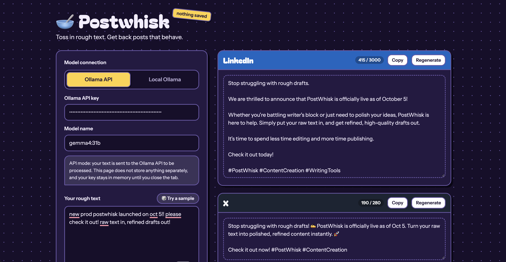

# postwhisk-hacktoberfest
Toss in rough text. Get polished, platform-ready posts back. Powered by local Ollama models (Qwen3.5:2b) and the Ollama Cloud API.

## Run the code using following

```
node server.js
```

Read more here: [dev.to post](https://dev.to/anubhabdaserrr/postwhisk-a-lightweight-llm-driven-web-app-to-generate-social-media-posts-36a8)


